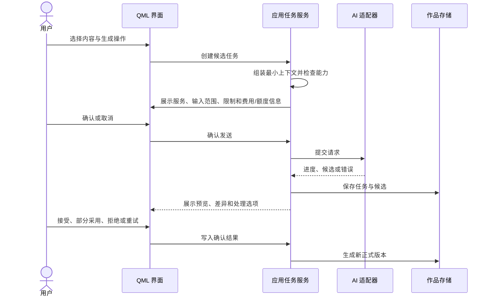

# AI 服务接入与生成任务

## 1. 服务配置模型

设置按能力管理服务，而不是要求所有任务共用一家服务。首阶段配置文本和图片；视频、语音、音乐和口型同步能力随后加入。每种能力可设置默认服务；发起某次任务时，用户可改选其他已配置服务。缺省服务、模型名称、端点、能力参数和凭据引用属于服务配置，实际选用的配置快照属于任务记录。

服务来源分为本地和云端。标记为“本地”的服务只能连接用户明确配置的本机服务地址；其他地址按外部网络服务处理。用户可在没有配置某项服务时继续手工创作。

## 2. 适配器边界

所有服务适配器实现统一能力契约：

- 报告支持的任务类型、输入模态、输出模态、文件限制、语言、上下文长度和已知服务限制；
- 验证任务输入，并产生服务可接受的请求；
- 返回规范化文本候选，或带服务原始 ID 的图片/音频/视频媒体资产引用及元信息，并提供耗时、用量信息和可读错误；
- 支持超时、取消、限流、重试分类和部分结果；
- 不修改作品正式内容，不直接写入任何正式领域内容或确认状态。

首版用内置适配器和配置描述支持服务。暂不开放任意本地原生插件加载，以免把用户可配置性变成不受控的代码执行入口。

## 3. 生成任务流程

生成前显示目标对象、服务/模型、选中的剧本文本、相关设定与参考素材、生成数量、已知限制，以及服务可提供的成本或额度信息。只发送完成任务所需的上下文，不默认发送整个作品。

候选经校验后独立保存。用户可比较、部分采用、合并为新版本、拒绝或重试。上游变更只将关联结果标记为可能过期，不自动重做。

## 4. 结构化输出和提示版本

每项 AI 操作声明输入字段、必需字段、长度限制和输出结构版本。文本类结果优先要求结构化 JSON，并通过应用层 schema 校验。解析失败时保留原始候选和错误，不把不完整内容写入正式稿。每个模板/提示配置有版本标识，使旧任务可还原其生成条件。

任务记录关联服务配置 ID（不含密钥）、模型、任务类型、提示版本、输入资产 ID、上下文清单、请求时间、状态、候选资产 ID、用户选择和可获得的费用/用量信息。敏感原文是否长期保留按用户的项目和服务隐私设置决定；日志不得复制 API 密钥。

## 5. 凭据和授权

- 外部服务首次使用时说明服务和已知数据处理信息并取得授权；之后每次仍显示实际发送范围。
- 用户确认前不得发送请求。确认后、实际提交前取消时不得发送；请求提交后取消仅表示尽力终止本地等待或服务任务，不保证服务端未收到输入或已删除输入。
- 用户可以按服务撤销授权；撤销后阻止该服务接收新内容。
- 密钥放操作系统密钥库；项目包不得包含密钥。
- 服务保留期限、训练使用、商业权利或费用未知时显示未知，不作保证。
- 配置远端兼容 API 时清晰显示其实际主机名；不能因为用户自定义就标为本地。

首发可支持不同服务 URL、模型 ID、API 密钥和能力参数的配置，但具体服务兼容协议及每项能力的认证字段在适配器规格中分别定义。

## 6. 状态和失败语义

任务状态：待用户确认、排队中、执行中、成功、部分成功、失败、已取消。任务记录应能区分“发送前取消”和“提交后取消/终止结果未知”。重试创建新的尝试记录并保留旧结果。对批量任务，父任务汇总镜头/项目状态；单项失败不回滚已经完成且保留的候选。

失败信息区分：无网络、认证失败、服务限流、余额/额度不足、输入不支持、内容策略拒绝、服务超时、响应格式错误、用户取消和本地存储失败。每类错误给出是否重试、如何修改输入或如何改用其他服务的建议。

## 7. 首阶段能力和后续能力

首阶段实现两类并存的交互：结构化创作操作，以及围绕当前作品/选中内容的上下文助手。助手可解释、分析和提出建议；用户明确要求生成或改写时，仍创建独立候选，经预览和用户确认后才写入正式作品。助手不得把对话建议直接写入作品。

上下文助手按用户当前选择组织工作上下文，支持查看、移除或补充将发送的内容。首阶段覆盖作品、剧集、角色、场次、剧本段落、镜头和素材上下文；未配置 AI 服务时，手工创作仍可继续，但 AI 助手不可用。助手回答本身不自动成为正式作品内容。

结构化操作包括故事/剧本生成、选定内容的续写/扩写/压缩/局部重写/润色/风格调整、创作圣经建议、场次/镜头草案、内容分析和图片参考生成。所有生成均先预览；用户确认才写入正式作品。

后续扩展：逐镜头及批量视频/动画、对白/配音、声音克隆授权、音乐/音效、口型同步、翻译和字幕。新能力复用同一任务生命周期，但可为媒体文件、长任务和批处理增加专用进度与容量规则。

## 8. 对应产品需求

- RFC-001 / REQ-AI-001–012、REQ-PROJ-009–012、RULE-001–003、NFR-PRIV-001–002
- RFC-002 / REQ-BIBLE-005–007、REQ-SCRIPT-004–010
- RFC-003 / REQ-VIS-001–008、REQ-CTX-001–004
- RFC-004 / REQ-VGEN-001–006、REQ-VGEN-010–016、REQ-FAIL-001–005
- RFC-008 / REQ-PRIV-001–017、REQ-TRACE-001–006
