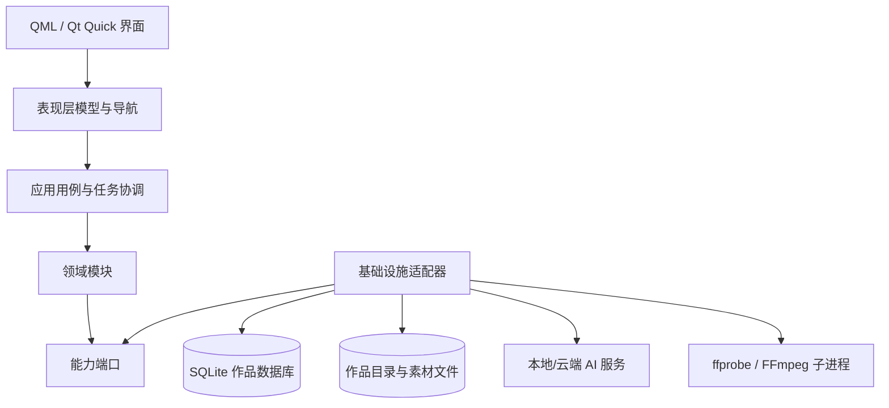

# 技术架构总览

## 1. 架构目标

架构需要支持本地优先的作品管理、可替换的 AI 服务、异步媒体任务和逐步扩大的创作能力。首阶段不应依赖在线服务才能打开作品、编辑内容或导出本地资料。

建议采用**模块化单体桌面应用**：一个 Qt 桌面程序按业务模块划分边界；耗时媒体操作由独立 FFmpeg 子进程承担；云端 AI 请求通过网络适配器发送；用户可选的本地推理服务保持进程外。当前不引入服务端账户系统或微服务架构。

## 2. 技术基线

| 领域 | 方案 |
|---|---|
| 桌面与界面 | Qt 6、QML/Qt Quick、Qt Quick Controls |
| 原生逻辑 | C++20；领域规则和应用用例由 C++ 管理，QML 负责呈现、输入和导航 |
| 构建 | CMake；依赖版本固定并审查许可证 |
| 项目元数据 | 暂定每个作品使用独立 SQLite 数据库；大型媒体文件放在作品目录的文件系统中。目录布局尚待原型验证和确认 |
| 媒体探测/抽帧/基础预览 | 探测和抽帧首阶段以受控的 ffprobe/FFmpeg 命令行子进程执行；只读预览后端在阶段 0 验证后确定 |
| AI 服务 | 按文本、图片、视频、音频等能力定义适配器；首阶段实现文本和图片能力 |
| 工作模式 | 单机本地项目；联网仅用于用户选择的云端生成或后续显式在线能力 |

Qt 文档推荐通过 CMake 构建 Qt 应用，并提供 Qt Quick 应用打包说明。具体 Qt 最低版本和 Windows 工具链在基础验证阶段锁定，不在需求讨论阶段虚构版本号。

## 3. 依赖方向



依赖从界面向应用和领域规则流动。领域模型不得直接依赖 QML、SQLite、HTTP、FFmpeg 命令或某一家 AI 服务。应用层通过端口调用存储、生成服务、文档格式和媒体工具适配器。

QML 不直接读写数据库、不组装 AI 提示词、不启动外部进程，也不包含作品状态转换规则。C++ 表现模型只暴露界面需要的属性、列表和命令；所有能改变作品正式状态的操作由应用用例校验。

## 4. 业务模块

下列模块覆盖完整产品目标；Video Generation 计划在阶段 2 交付，Voice & Sound 与 Subtitles & Localization 计划在阶段 3 交付，Editing 计划在阶段 4–5 逐步交付。AI Tasks 负责通用任务生命周期和服务调用，不取代这些领域模块对内容、版本和授权状态的管理。

| 模块 | 职责 | 主要依赖 |
|---|---|---|
| Workspace | 资料库目录选择、作品列表、新建/复制/归档/删除、工作区可用状态 | 项目存储 |
| Project | 作品、剧集、保存状态、版本和恢复 | 存储、历史 |
| Story Bible | 角色、地点、道具、故事规则、确定性状态及连续性关系 | Project、Assets |
| Script | 故事简报、故事大纲、剧本结构、版本比较、剧本格式导入导出 | Bible、文档适配器 |
| Storyboard | 场次、镜头、镜头关系、时间预算、视觉参考 | Script、Bible、Assets |
| Video Generation | 视频/动画镜头的生成输入、候选版本、服务限制和生成后连续性审核 | Storyboard、Bible、Assets、AI Tasks |
| Voice & Sound | 角色声音设定、对白/声音资产关联、授权状态、试听和口型任务关系 | Script、Storyboard、Assets & Rights、AI Tasks |
| Subtitles & Localization | 字幕草案与编辑、译文版本、术语维护和双语关联 | Script、Voice & Sound、Storyboard、Assets |
| Assets & Rights | 原始素材、候选素材、派生素材、来源、授权和引用关系 | 存储 |
| AI Tasks | 按任务选择服务、整理上下文、请求确认、排队、取消、候选预览和任务记录 | Settings、AI Provider、Assets、Bible、Script、Storyboard |
| Media Tools | 媒体探测、抽帧、预览副本和任务状态 | FFmpeg Adapter、Assets |
| Checks | 一致性、内容质量、授权/来源风险的定位和状态；读取业务事实并生成检查结果，不修改被检查内容 | Project、Story Bible、Script、Storyboard、Assets & Rights、AI Tasks、Media Tools、Voice & Sound、Subtitles & Localization、Editing |
| Delivery | 首阶段剧本、分镜、参考图和资料包交付；后续成片、字幕、声音、语言版本和发布预设交付 | Script、Storyboard、Video Generation、Voice & Sound、Subtitles & Localization、Assets、Checks、Media Engine |
| Settings | 资料库目录、AI 服务配置、默认能力路由、显示和导出偏好；保存服务配置并管理凭据引用，不执行生成任务 | 本地设置、系统密钥库 |
| Editing | 多轨时间线、剪辑操作、效果、声音后期和成片导出 | Video Generation、Voice & Sound、Subtitles & Localization、Timeline Model、Media Engine |

模块通过明确的应用服务交互；不得用全局可变对象共享作品内容。跨模块引用使用稳定 ID，而不是依赖界面行号或显示名称。

## 5. 程序和任务边界

桌面主程序负责窗口、作品状态、任务调度和交互。长时间任务不得在界面线程运行：网络请求通过异步网络层处理；CPU 工作进入受限线程池；ffprobe/FFmpeg 作为可监控、可取消的子进程运行。

任务统一提供任务 ID、所属作品、能力类型、状态、进度、可取消标记、输入范围、错误类别和产生的资产 ID。应用关闭或异常退出后，重新打开作品时应能识别未完成任务，并显示其结果是可恢复、需重试还是已中断；不得伪报成功。

首阶段任务状态至少包括：待确认、已排队、执行中、成功、部分成功、失败和已取消。生成候选先保存为候选状态，只有用户明确接受后才成为正式内容。

## 6. 推荐源码边界

```text
src/
  app/                 # 启动、依赖装配、窗口生命周期
  presentation/        # QML、C++ ViewModel、导航和对话框
  application/         # 用例、命令、任务协调和验证
  domain/              # 作品、创作圣经、剧本、分镜、资产和检查规则
  ports/               # 存储、AI、文档、媒体和密钥库抽象
  adapters/
    persistence/       # SQLite 与文件系统
    ai/                # 各 AI 服务适配器
    documents/          # Fountain、FDX、DOCX、PDF 等格式
    media/              # FFmpeg/ffprobe 与后续播放/渲染引擎
  resources/            # 图标、主题、默认模板
tests/
  unit/
  integration/
  qml/
```

这是推荐代码组织，不是对现有代码结构的描述。具体库和类名在基础验证通过后再冻结。

## 7. 质量属性

- **离线**：项目打开、文本编辑、分镜编辑、已有素材查看和本地资料导出不访问网络。
- **数据安全**：保存采用数据库事务；大文件先写入临时路径，校验后再登记为可用资产；失败不能破坏源文件。
- **响应性**：QML 主线程只做呈现工作；缩略图和列表采用分页/按需加载，避免一次载入整个作品媒体。
- **恢复能力**：任务失败只影响当前任务；版本恢复写入新版本，不覆盖历史。
- **可替换性**：AI、文档格式、媒体探测和未来剪辑引擎均有适配边界。
- **可访问性**：按 RFC-001 的 WCAG 2.2 AA 目标验收实际已交付的核心流程；逐项记录满足、未满足或不适用状态及理由，覆盖键盘与可见焦点、对比度与非颜色状态、辅助技术名称/状态和放大显示。分镜画布、时间线和字幕编辑等复杂区域不能默认排除，后续阶段必须分别复核新增流程。
- **可诊断性**：日志按任务 ID 关联；不记录密钥，不默认记录完整私密提示词或素材内容。

## 8. 安全和隐私边界

API 密钥保存在操作系统密钥存储中，作品数据库只保存凭据引用。Windows 首发使用 Windows Credential Manager 或 DPAPI 能力；将来支持 macOS/Linux 时分别使用系统密钥库。任何服务请求前，界面显示服务、发送内容范围和已知数据处理信息；用户可移除上下文或取消。

本地生成服务只在明确配置为本机地址时标记为本地路径。用户填写远端局域网/公网地址时，应按网络服务处理并说明数据会离开本机。应用不得自动上传整个作品目录。

## 9. 验证要求

- 单元测试覆盖领域状态转换、版本规则、上下文选择和候选确认。
- 存储集成测试覆盖自动保存、事务中断、迁移、恢复、磁盘只读和空间不足。
- AI 适配器契约测试使用模拟服务验证结构化响应、取消、超时、限流和部分结果。
- 媒体集成测试使用许可明确的小型图片/视频/音频样例验证探测、抽帧、只读预览、失败和取消；预览后端不支持的素材必须显示具体限制。
- QML 测试覆盖键盘路径、缩放、焦点、空状态、错误状态和大列表行为。
- 打包测试在干净的 Windows 10/11 虚拟机验证 QML 插件、媒体运行时和缺失依赖提示。

## 10. 官方技术参考

- [Qt QML](https://doc.qt.io/qt-6/qtqml-index.html)、[Qt Quick Controls](https://doc.qt.io/qt-6/qtquickcontrols-index.html)、[Qt Quick 部署](https://doc.qt.io/qt-6/qtquick-deployment.html)
- [Qt CMake 入门](https://doc.qt.io/qt-6/cmake-get-started.html)
- [Qt LGPL/GPL 义务](https://www.qt.io/licensing/open-source-lgpl-obligations)
- [SQLite 使用场景](https://www.sqlite.org/whentouse.html) 与 [WAL 模式限制](https://www.sqlite.org/wal.html)
- [Windows CryptProtectData](https://learn.microsoft.com/en-us/windows/win32/api/dpapi/nf-dpapi-cryptprotectdata)
- [Windows 10 Home/Pro 生命周期](https://learn.microsoft.com/en-us/lifecycle/products/windows-10-home-and-pro)：常规支持于 2025-10-14 结束；兼容运行不等于该操作系统仍受微软安全支持。
